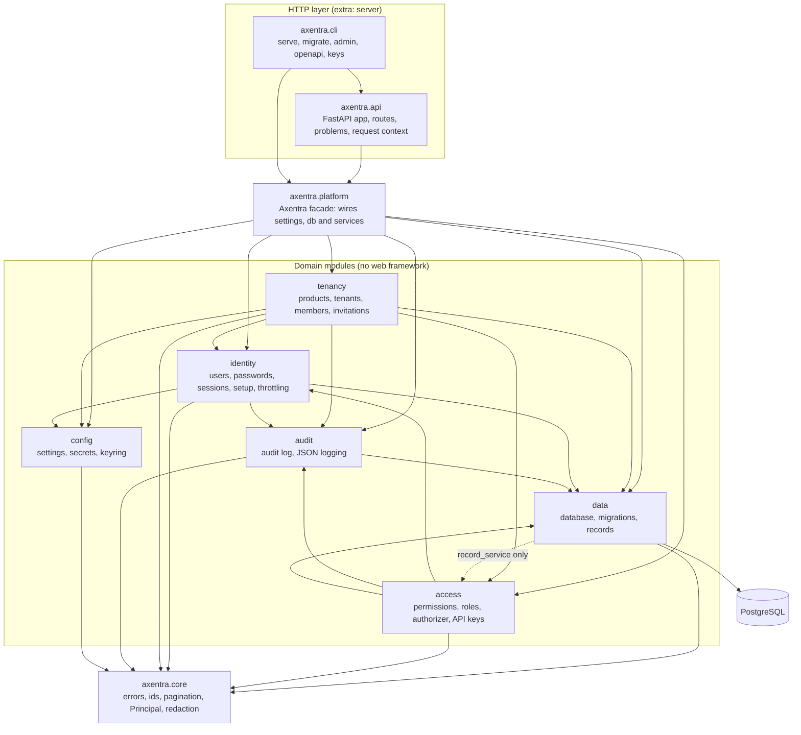
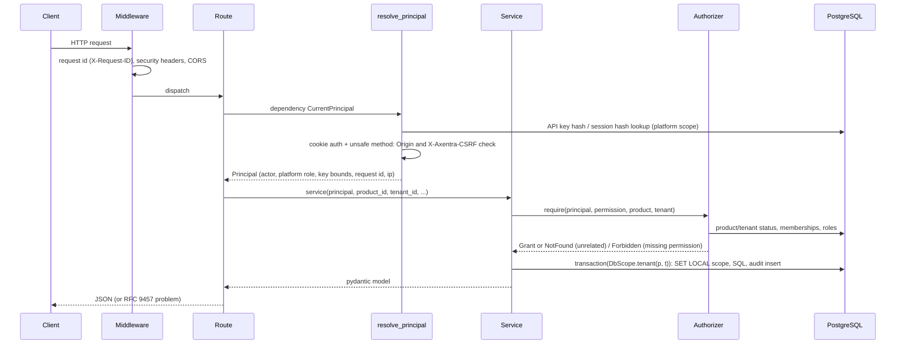

# Architecture overview

Axentra is a **modular monolith**: one installable Python package (`axentra`) with internal
modules, optional extras for heavy dependencies, and one PostgreSQL database
([ADR 0001](../adr/0001-modular-monolith-single-package.md)). It can be embedded as a library or
run as an HTTP service; both use the same services.

## Modules and dependencies



Arrows point from the importing module to the imported one (verified against the imports in
`src/axentra`). The database layer (`axentra.data.database`, `migrations`, `records`) depends
only on `core`; the authorized record service (`axentra.data.record_service`) sits above it and
uses the authorizer and the audit log, which is why `data` and `access` reference each other at
package level. `access` uses `identity` only for token hashing.

Modules planned for Phase 2/3 (storage, events/jobs/webhooks, usage, billing, notify,
observability, realtime) will be added as further domain packages under the same rules; they are
not part of the code described here. See [ROADMAP](../ROADMAP.md).

## Layering rules

1. **`core` is the bottom layer.** It imports nothing else from Axentra.
2. **Domain packages never import FastAPI, Starlette, uvicorn, `axentra.api` or `axentra.cli`.**
   They raise `axentra.core.errors` exceptions that carry a stable `code` and HTTP `status`, so
   the HTTP layer can render them without knowing the module.
3. **The API is thin.** A route parses and validates input, resolves the principal, calls one
   service method and returns its model. Authorization, scoping, auditing and SQL live in the
   services.
4. **No dependency on Nodestro, orkexa or Axentra Studio**, at import level or in package
   metadata.

Enforcement:

- import-linter contracts in `pyproject.toml` (`lint-imports`, run in CI): domain modules do not
  depend on the HTTP layer or web frameworks; Axentra never depends on Nodestro/orkexa/Studio;
  core is the bottom layer.
- `tests/unit/test_architecture.py`: the same rules via AST, plus "the library imports with
  FastAPI/Starlette/uvicorn blocked" and "no forbidden names in the package dependencies".
- CI `package` job: the core wheel installs and imports without extras and without FastAPI; the
  server install contains no Nodestro/orkexa/Studio package.
- `axentra.api.app.check_routes`: the app refuses to start if a `/v1` route neither depends on
  `resolve_principal` nor is listed in `PUBLIC_ROUTES`.

## Request flow (HTTP)



1. The middleware accepts a valid incoming `X-Request-ID` (`[A-Za-z0-9._-]{1,64}`) or creates
   one, and adds `X-Request-ID`, `Axentra-API-Version` and security headers to every response.
2. `resolve_principal` authenticates: `Authorization: Bearer axk_...` (or `X-API-Key`) as API
   key, any other bearer token as session token, otherwise the session cookie. Cookie requests
   with `POST/PUT/PATCH/DELETE` must pass the Origin and CSRF checks.
3. The service authorizes with `Authorizer.require`, opens a transaction with the narrowest
   `DbScope` it needs and writes the audit event in the same transaction as the change.
4. Errors are `AxentraError` subclasses, rendered as `application/problem+json`
   ([ADR 0009](../adr/0009-errors-rfc9457.md)). Unexpected exceptions become a generic `500`
   without details.

## Security context propagation

There is no ambient security state: no thread-locals, no globals, no "current user". Every
service method that acts on behalf of someone takes a `Principal` as its first argument:

```python
@dataclass(frozen=True)
class Principal:
    actor: Actor                      # kind (user | api_key | system), id, display
    platform_role: PlatformRole | None
    session_id: str | None
    api_key_product_id: str | None    # API keys: bound product
    api_key_tenant_id: str | None     # API keys: optional bound tenant
    api_key_permissions: frozenset[str]
    request_id: str | None            # copied into audit events
    ip: str | None
```

- The HTTP layer builds it once per request; library users build it with
  `ax.identity.resolve_session(token)` or `ax.api_keys.authenticate(token)`.
- `Principal.system(reason)` is a trusted in-process caller with the platform admin role (CLI,
  startup, future workers). It is never created from a request; code that creates it is
  responsible for the decision.
- The database scope is also explicit: `Database.transaction(DbScope.tenant(p, t))` sets
  `axentra.scope`, `axentra.product_id`, `axentra.tenant_id` with `set_config(..., true)` for this
  transaction only, and row-level security uses them
  ([ADR 0005](../adr/0005-row-level-security.md)).
- The only context variable is the request id for log correlation
  (`axentra.audit.logging.request_id_var`); it carries no authority.

## Library vs HTTP usage

| | Library (in-process) | HTTP API |
|---|---|---|
| Authentication | Your code: `resolve_session`, `api_keys.authenticate`, or `Principal.system` | Axentra: cookie, bearer session token, API key |
| CSRF / Origin | Not applicable; your web layer must protect its own cookie endpoints | Enforced for cookie-authenticated unsafe requests |
| Authorization | Enforced by the services (`*Service` classes) | Same services |
| RLS | Enforced if the database role is not a superuser and has no BYPASSRLS | Same |
| Low-level access | `ax.db.transaction(...)`, `RecordStore` and similar classes do **no** authorization | Not exposed |
| Rate limiting | Login/setup throttling inside `IdentityService` | Same, plus the optional per-credential/per-IP limit and the request body limit (`security.*`, HTTP middleware) |
| Security headers, CORS, request ids | Your web layer | Axentra middleware |
| Processes | Your process owns the pool (`ax.start()` / `ax.close()`) | `axentra serve` (uvicorn), one pool per process |

Boundaries to keep in mind when embedding:

- **Services authorize, stores do not.** `RecordService` checks permissions; `RecordStore` and
  raw `ax.db.transaction` do not. Use the lower layers only after your own authorization, and
  always with the narrowest scope.
- **`Principal.system()` is all-powerful.** Never derive it from user input.
- **Operational duties are yours in library mode**: run `ax.migrate()` (or `axentra migrate`) once
  per deployment, call `ax.start()` before use (it opens the pool, verifies that the role does not
  bypass RLS, and in single-product mode creates the product), and `ax.close()` on shutdown.
- **Sync API.** Services are synchronous and block on PostgreSQL. In an async framework, call
  them from a thread pool, as FastAPI does for `def` routes ([ADR 0004](../adr/0004-sync-core.md)).
- **One database, one pool per process.** Size `database.pool_max` x processes below the
  server's `max_connections`.

## Repository layout

```
src/axentra/          package (core, config, data, identity, tenancy, access, audit, api, cli, platform.py)
src/axentra/data/sql/ Axentra migrations (namespace "axentra")
openapi/              committed OpenAPI contract (axentra-v1.json)
tests/unit, tests/integration   unit tests; PostgreSQL integration tests (non-superuser role)
deploy/               Dockerfile constraints, compose files, example configuration
docs/                 architecture, ADRs, guides, operations, roadmap, TODO
```
