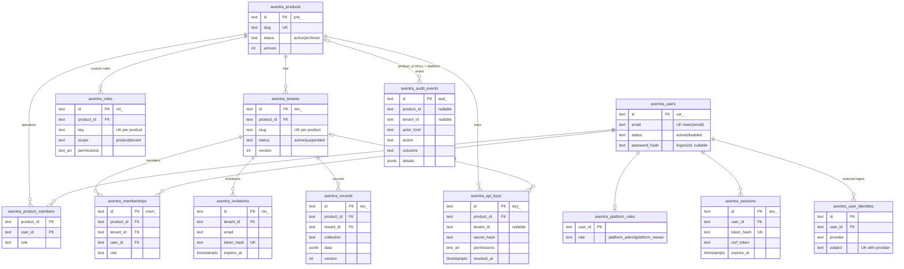

# Security model

This document describes how Axentra (as of `0.1.0.dev0`, migration `0001_foundation`) identifies
callers, decides what they may do, isolates data between products and tenants, and protects
secrets. It states limits as plainly as guarantees. Modules planned for Phase 2/3 are mentioned
only where they change the threat model, and are marked as planned.

## Data model (migration 0001)



Further tables without relationships: `axentra_login_states` (OIDC state, nonce, PKCE verifier;
used by the OIDC login flow that is being added), `axentra_setup_tokens` (hashed first-run
tokens), `axentra_rate_limits` (login throttling counters), `axentra_schema_migrations`.

Row-level security is enabled and forced on: products, product_members, tenants, memberships,
invitations, roles, api_keys, audit_events, records. It is **not** enabled on users,
user_identities, platform_roles, sessions, login_states, setup_tokens, rate_limits and
schema_migrations (see [Limits of RLS](#limits-of-row-level-security)).

## Identities

| Identity | Stored in | Gets permissions from |
|---|---|---|
| **User** (global) | `axentra_users` | Platform role, product operator role, tenant membership roles |
| **Platform admin / viewer** | `axentra_platform_roles` | `platform_admin`: every permission. `platform_viewer`: all `*:read` permissions plus `product:read`, `tenant:read`, `platform:settings`, `platform:audit` |
| **Product operator** | `axentra_product_members` | A product role (built-in `product_owner`, `product_admin`, `product_support`, `product_viewer`, or a custom product role). Tenant permissions of a product role apply in every tenant of that product |
| **Tenant member** | `axentra_memberships` | A tenant role (built-in `tenant_owner`, `tenant_admin`, `member`, `viewer`, or a custom tenant role), limited to tenant-scoped permissions, in that tenant only |
| **API key** | `axentra_api_keys` | Its explicit permission list, confined to one product and optionally one tenant |
| **System** | not stored | `Principal.system(reason)`: platform admin, for in-process callers (CLI, startup). Never built from a request |

Users are global: one account (one email) can be an operator of one product and a member of
tenants in several products. A user sees a product only through a relation to it. The first
platform admin is created with a one-time setup token (`axentra admin setup-token`, valid
`security.setup_token_ttl_minutes`, stored hashed, usable only while no platform admin exists).

The permission catalog (`GET /v1/permissions`, `axentra.access.permissions.CATALOG`) has three
scopes: `platform` (granted only by platform roles, never by API keys or product/tenant roles),
`product` and `tenant`. Custom product roles may hold product and tenant permissions, custom
tenant roles only tenant permissions; platform permissions are never allowed. The catalog is fixed
in code in this version.

## Authorization rules

All decisions go through `axentra.access.authorizer.Authorizer`:

1. **Default deny.** A permission is granted only by a platform role, a product role, a tenant
   role or an API key's list. Unknown role keys grant nothing.
2. **No existence oracle.** A principal with no relation to a product or tenant gets `404 Not
   found`, exactly as if the id did not exist. A related principal without the permission gets
   `403 Forbidden`. API keys get `404` for any product or tenant other than their own.
3. **Product-level view for tenant members.** A user who is only a tenant member of a product
   (no operator role) gets `product:read` at product level, to pick a tenant, and nothing else.
4. **Archived products and suspended tenants.** Platform admins keep full access (to inspect and
   restore). Platform viewers keep read access. Everyone else, including API keys, gets
   `403 Forbidden`.
5. **Key confinement.** An API key acts only in its product. A tenant-bound key has no
   permissions at product level and only its own tenant at tenant level. Platform permissions are
   always stripped from keys.
6. **No privilege escalation when creating keys.** Creating a key needs `api_keys:manage`, and
   every permission granted to the key must be one the creator holds at product level; otherwise
   `403`. Rotation copies the old key's permissions and re-runs the same check.
7. **Guard rails.** The last platform admin cannot be disabled or demoted; the last product
   owner and the last tenant owner cannot be removed or demoted; a user cannot disable themself;
   only platform admins change platform roles.

Services call `authz.require(principal, permission, product_id, tenant_id)` before any data
access. Low-level classes (`RecordStore`, `Database.transaction`) do not authorize.

## Row-level security design

Row-level security (RLS) is the second line of defense: services already filter by product and
tenant; RLS makes a forgotten or wrong `WHERE` clause fail closed
([ADR 0005](../adr/0005-row-level-security.md)).

**Scope per transaction.** `Database.transaction(scope)` starts a transaction and runs

```sql
SELECT set_config('axentra.scope', 'tenant', true),
       set_config('axentra.product_id', 'prd_...', true),
       set_config('axentra.tenant_id', 'ten_...', true);
```

The third argument `true` makes the settings transaction-local, so they disappear at commit or
rollback and never leak to the next user of a pooled connection (tested in
`tests/integration/test_rls.py`).

**One policy function.**

```sql
CREATE FUNCTION axentra_scope_allows(p text, t text) RETURNS boolean LANGUAGE sql STABLE AS $$
    SELECT CASE current_setting('axentra.scope', true)
        WHEN 'platform' THEN true
        WHEN 'product' THEN p IS NOT NULL AND p = current_setting('axentra.product_id', true)
        WHEN 'tenant'  THEN p IS NOT NULL AND p = current_setting('axentra.product_id', true)
                            AND (t IS NULL OR t = current_setting('axentra.tenant_id', true))
        ELSE false
    END
$$;
```

Every protected table has `ENABLE ROW LEVEL SECURITY`, `FORCE ROW LEVEL SECURITY` (so the policy
applies to the table owner too) and one policy `scope` with the same expression in `USING` (read,
update, delete) and `WITH CHECK` (insert, update):

| Scope | Sees and may write |
|---|---|
| none / unknown | nothing |
| `platform` | everything |
| `product` (P) | rows of product P (all its tenants and product-level rows) |
| `tenant` (P, T) | rows of tenant T, **plus product-level rows of P whose `tenant_id` is NULL** (e.g. product-wide API keys, product-level audit events, the product row itself) |

Audit events with `product_id IS NULL` (platform events) are readable only in platform scope;
they may be inserted from any scope.

**Non-superuser role checked at startup.** `Axentra.start()` calls `Database.check_role`: if the
connected role is a superuser or has `BYPASSRLS`, startup fails in production unless
`database.allow_superuser = true` is set explicitly. In `development` and `test` it is allowed.
The compose setup uses an owner role for migrations and a separate application role for the API
(`deploy/compose/initdb/01-roles.sql`); the test suite runs as a non-superuser owner role so the
policies are really exercised.

### Limits of row-level security

- **Platform scope sees all.** Services that need cross-product reads (authorization lookups,
  authentication, admin listings) use `DbScope.platform()`. RLS protects nothing in those
  transactions; correctness depends on the service code.
- **Tenant scope sees product-level rows** of the same product (see the table above). Product
  tables that hold product-wide data should not be readable by tenant code if that matters;
  model it with separate tables or a non-null `tenant_id`.
- **Unique constraints leak existence.** An `INSERT` that collides with a row hidden by RLS still
  fails with a unique violation. Ids are random, so this matters only for natural keys: product
  slugs (global), tenant slugs (per product), role keys (per product), user emails (global).
- **Superusers and `BYPASSRLS` roles bypass all policies**, and so does any role in production if
  `allow_superuser` is set. Database administrators and backups see everything.
- **Global tables have no RLS**: `axentra_users`, `axentra_sessions`, `axentra_platform_roles`,
  `axentra_user_identities`, `axentra_login_states`, `axentra_setup_tokens`,
  `axentra_rate_limits`. Users are global identities and are protected only by the service layer
  (for example, product admins list only users related to their product). Tracked in
  [TODO](../TODO.md).
- **RLS does not authorize.** It separates scopes; who may use a scope is decided by the
  authorizer before the transaction starts.

## Sessions, CSRF, origins and cookies

([ADR 0006](../adr/0006-sessions-and-csrf.md))

- **Server-side sessions.** Login returns a random 256-bit token; the database stores only its
  SHA-256 hash, plus a per-session CSRF token. A session ends at `expires_at`
  (`security.session_ttl_hours`, default 12 h), after `security.session_idle_minutes` (default
  120) without use, on logout, on revocation (own sessions or by an admin), when the user is
  disabled, and (for other sessions of the user) when the password changes. `last_seen_at` is
  updated at most once a minute.
- **Session fixation.** A new token is generated at every login and setup; tokens are never
  accepted from query strings or set by the client.
- **Cookie.** `HttpOnly; SameSite=Lax; Path=/`, `Secure` and the `__Host-axentra-session` name
  when `security.public_url` is `https://`; on plain HTTP (local development only) the name is
  `axentra-session` without `Secure`.
- **CSRF.** Requests authenticated by the cookie with `POST`, `PUT`, `PATCH` or `DELETE` must send
  `X-Axentra-CSRF` equal to the session's CSRF token (from `GET /v1/auth/session` or the login
  response), compared in constant time. Bearer-authenticated requests (API keys, session tokens
  used by SDKs/CLIs) need no CSRF token, because browsers never attach them automatically.
- **Origin check.** For the same cookie requests, and for login and setup (login CSRF), an
  `Origin` header, if present, must be `security.public_url` or one of
  `security.allowed_origins`; otherwise `403`.
- **CORS.** Only the configured `allowed_origins` get credentialed CORS responses; `*` is
  rejected at startup.

## Passwords

Argon2id (argon2-cffi defaults, RFC 9106 profile), rehash on login when parameters change.
Policy: at least `security.password_min_length` (default 12) characters, at most 1024, not equal
to the email, at least 4 distinct characters. Logins for unknown accounts verify against a dummy
hash so timing does not reveal whether an account exists; the error message is always "wrong
email or password".

## API keys

([ADR 0007](../adr/0007-api-keys.md)) Format `axk_<26 char id>_<43 char secret>`. Shown exactly
once at creation or rotation; the database keeps the SHA-256 hash of the secret, compared in
constant time. A key has a product, an optional tenant, an explicit permission list and an
optional expiry. Rotation creates a replacement and revokes the old key immediately or after a
grace period (at most 7 days). `last_used_at` is updated at most once a minute. Keys are sent as
`Authorization: Bearer axk_...` (or `X-API-Key`).

## Secrets and the keyring

- **Secret references.** Settings ending in `_ref` take `env:NAME` or `file:/path` (e.g. Docker or
  Kubernetes secrets). In production, inline secrets (`security.master_keys`,
  `oidc[].client_secret`) are refused at startup.
- **Keyring.** `security.master_keys_ref` resolves to `kid:base64key[,kid2:base64key...]`
  (32-byte keys, alphanumeric key ids). `SecretBox` encrypts with AES-256-GCM using the first key
  and decrypts with any key in the ring. Ciphertexts look like `axs1.<kid>.<nonce>.<ct+tag>`; the
  associated data binds the key id and a caller-supplied context (for example table and row id),
  so a ciphertext copied to another row does not decrypt. Encrypted columns: OIDC login states
  (`nonce`, `code_verifier`, `invitation_token`), webhook signing secrets (current and previous),
  rendered notification content and the local mailbox. Product backends register theirs with
  `ax.register_encrypted_column(EncryptedColumn(...))` so rotation covers them.
  Development without a configured keyring writes `./var/dev-keyring`; tests use ephemeral keys.
- **Rotation procedure** ([ADR 0011](../adr/0011-keyring-rotation.md)):
  1. Generate a key: `axentra keys generate --kid k2`.
  2. Put it **in front**: `k2:...,k1:...`. Back up the new keyring (see
     [BACKUP_RESTORE](../operations/BACKUP_RESTORE.md)).
  3. Restart every process. New values are encrypted with `k2`; values under `k1` still decrypt.
  4. Re-encrypt stored values with the active key: `axentra secrets reencrypt --dry-run` reports,
     per column, the number of values per key id; `axentra secrets reencrypt` rewrites every value
     not under the active key in batches (one transaction per batch, compare-and-swap per row, so
     it is safe while the API runs and can be re-run after an interruption). Values that cannot be
     decrypted are counted as `failed` and left unchanged (exit code 2).
  5. Remove `k1` only when the dry run shows no value under `k1` (and no backup you may still
     restore needs it), then restart again.
  Decrypting a value whose key id is not in the ring fails with a configuration error naming the
  missing key id; losing a key means losing the values encrypted with it.
- **Hashes, not ciphertexts, for credentials** that are only compared: session tokens, API key
  secrets, invitation and setup tokens (SHA-256 of 256-bit random values), passwords (Argon2id).

## Redaction

`axentra.core.redaction` removes secrets from logs, problem details and audit details: values of
keys matching `password|secret|token|api_key|authorization|cookie|private_key|credential|signature|csrf`
are replaced with `[redacted]`, and token-like strings (Axentra API keys, `Bearer ...`, JWTs,
passwords in `postgres://user:pass@` URLs) are masked in free text. The JSON log formatter and the
problem renderer apply it to every message; the audit log applies it to `details` before
storing. Redaction is a safety net; code must still avoid logging secrets.

## Rate limiting

Only authentication is throttled in this version: failed password logins count per account
(`security.login_rate_per_minute`, default 10) and per client IP (three times that), and failed
setup-token attempts per IP, in fixed one-minute windows stored in PostgreSQL (shared by all API
processes). Exceeding a budget returns `429` with `Retry-After: 60`. Fixed windows allow up to
twice the budget across a window boundary.

General request rate limiting is optional and **off by default** (`security.rate_limit_per_minute`
per credential, `security.rate_limit_ip_per_minute` per client IP, `security.rate_limit_burst`).
It is an in-memory token bucket per process: a request is charged to a hash of its credential
(bearer token, API key or session cookie; the client IP for anonymous requests) and independently
to its client IP, before authentication runs. An empty bucket answers `429` (`rate_limited`) with
a computed `Retry-After`. Health checks and `/metrics` are never limited.

Trade-off: the in-memory buckets cost nothing per request (no database write) but are not shared;
N API processes allow N times the configured rate and a restart refills them. The database-backed
fixed windows (`axentra_rate_limits`) remain for logins, where a shared budget matters. For a hard
global limit use the reverse proxy or an API gateway.

## Request body size

`security.max_body_bytes` (default 10 MiB) caps every request body: a larger `Content-Length` is
answered with `413` (`payload_too_large`, problem+json) before the body is read, and a chunked body
is aborted with `413` as soon as it passes the limit. File uploads are exempt and use
`storage.max_file_bytes` (checked while streaming). Records are additionally capped at 256 KiB.

## Proxy headers

uvicorn's proxy header handling is disabled. Axentra honours `X-Forwarded-For` only when the TCP
peer is in `security.trusted_proxies` (IPs or CIDRs); it then walks the header from the right and
takes the first address that is not a trusted proxy. Otherwise the peer address is the client IP
(used for throttling and audit). `X-Forwarded-Proto` is not used: cookie security and HSTS follow
`security.public_url`.

## HTTP hardening

Every response carries `X-Content-Type-Options: nosniff`, `Referrer-Policy: no-referrer`,
`X-Frame-Options: DENY`, `Cross-Origin-Resource-Policy: same-site` and
`Content-Security-Policy: default-src 'none'; frame-ancestors 'none'` (not on `/v1/docs`, the
Swagger UI), `Strict-Transport-Security` when the public URL is HTTPS, and `Cache-Control:
no-store` on `/v1/auth/*` and `/v1/me*`. The OpenAPI document (`/v1/openapi.json`) and Swagger UI
(`/v1/docs`) follow `security.api_docs`: `public`, `authenticated` (session or API key) or
`disabled` (404). Default: `disabled` in production, `public` otherwise. `axentra openapi export`
works in every mode. Route protection is checked at startup (`check_routes`; the two docs routes are
listed in `PUBLIC_ROUTES` and are only registered unauthenticated in `public` mode).

## Threat model

| Threat | Mitigation | Residual risk / notes |
|---|---|---|
| IDOR / BOLA (foreign ids in the path) | Authorizer checks every product/tenant id against the principal; unrelated scopes return `404`; queries filter by product and tenant; RLS confines unfiltered queries; cross-tenant and cross-product tests | Platform-scope queries rely on code review; global users table is not under RLS |
| Privilege escalation | Deny by default; platform permissions never granted to keys or product roles; key creators cannot grant what they lack; last-owner/admin guards | Product roles hold tenant permissions in all tenants by design |
| CSRF | SameSite=Lax cookie, CSRF header token for unsafe cookie requests, Origin allow-list, login CSRF check | Browsers that send no `Origin` rely on the CSRF token alone (sufficient) |
| XSS | The API returns JSON only (`application/json`, `application/problem+json`) with `nosniff` and a `default-src 'none'` CSP; cookies are HttpOnly | Frontends (product UIs, Studio) must escape data themselves; `/v1/docs` loads Swagger UI assets from a CDN without the strict CSP |
| SQL injection | Parameterized queries only (psycopg placeholders); dynamic identifiers come from fixed allow-lists (sort fields, regex-checked field names); JSON filters passed as bound `jsonb` | Product code using `ax.db` must follow the same rule |
| Session fixation / theft | New random token per login, hash-only storage, HttpOnly + Secure + `__Host-` cookie, idle and absolute expiry, revocation | A stolen token is valid until it expires or is revoked |
| Brute force / credential stuffing | Argon2id, per-account and per-IP throttling, uniform error message and timing | Fixed windows; no CAPTCHA or lockout; distributed attacks across many IPs are limited only per account |
| SSRF | No outbound requests from user input in this version | Planned webhooks (Phase 2) must validate target URLs, block private ranges and redirects |
| Secret leakage | Hash-only credentials, secrets shown once, secret references, AES-GCM with context binding, redaction in logs/problems/audit, startup refusal of inline secrets in production | Database dumps contain hashes and ciphertexts; the keyring must be stored separately |
| RLS bypass via misconfiguration | Startup check for superuser/BYPASSRLS; separate owner and app roles in compose | `allow_superuser = true` disables this protection |
| Spoofed client IP | `X-Forwarded-For` only from `trusted_proxies` | Wrong proxy configuration makes throttling per IP ineffective |
| Denial of service | Statement timeout, page size limit (200), record size limit (256 KiB), field length limits, request body limit (`security.max_body_bytes`), optional per-credential/per-IP rate limits | Rate limits are per process and off by default; use the reverse proxy for global limits and slow-client (slowloris) protection |

## EU hosting and GDPR

Axentra is software, not a service; whether a deployment complies with the GDPR depends on how it
is operated. **Axentra makes no claim of GDPR compliance.** It provides technical measures that
help an operator meet their obligations:

| Axentra provides | The operator is responsible for |
|---|---|
| Self-hosting on infrastructure of your choice (EU regions possible); no telemetry or calls home | Choosing hosting, sub-processors and data transfer mechanisms; data processing agreements |
| Tenant and product separation (authorization + RLS) | Defining controllers/processors per product and tenant |
| Encryption of stored secrets (AES-256-GCM), hashed credentials | Encryption at rest of disks and backups, TLS termination, key management |
| Audit trail of security-relevant changes with actor, time, request id and IP | Retention policy for audit events and logs (purge helpers exist; scheduling is not automated yet) and informing data subjects |
| Data minimization in logs (redaction, no request bodies logged) | What personal data products store in records and their own tables |
| Tenant deletion cascades to tenant data in Axentra tables (and product tables that follow the guide) | Data subject requests (access, rectification, erasure, portability) across users, records, backups and logs; there is no built-in export or user erasure endpoint yet |
| Configurable session lifetimes, password policy, login throttling | Records of processing, DPIAs, breach notification, staff access to the database and backups |
