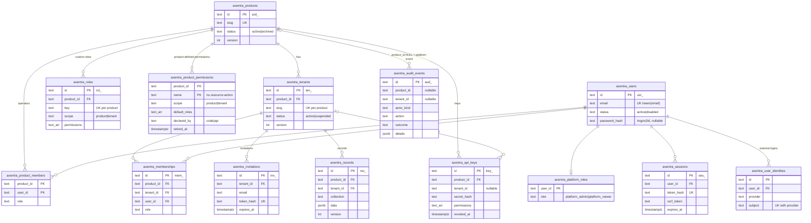

# Security model

This document describes how Axentra (as of `0.1.0.dev0`, migration `0001_foundation`) identifies
callers, decides what they may do, isolates data between products and tenants, and protects
secrets. It states limits as plainly as guarantees. Modules planned for Phase 2/3 are mentioned
only where they change the threat model, and are marked as planned.

## Data model (migration 0001)



Further tables without relationships: `axentra_login_states` (OIDC state, nonce, PKCE verifier;
used by the OIDC login flow that is being added), `axentra_setup_tokens` (hashed first-run
tokens), `axentra_rate_limits` (login throttling counters), `axentra_schema_migrations`.

Row-level security is enabled and forced on: products, product_members, tenants, memberships,
invitations, roles, product_permissions, api_keys, audit_events, records (and the module tables,
see the module docs). It is **not** enabled on users,
user_identities, platform_roles, sessions, login_states, setup_tokens, rate_limits and
schema_migrations (see [Limits of RLS](#limits-of-row-level-security)).

## Identities

| Identity | Stored in | Gets permissions from |
|---|---|---|
| **User** (global) | `axentra_users` | Platform role, product operator role, tenant membership roles |
| **Platform admin / viewer** | `axentra_platform_roles` | `platform_admin`: every permission. `platform_viewer`: all `*:read` permissions plus `product:read`, `tenant:read`, `platform:settings`, `platform:audit` |
| **Product operator** | `axentra_product_members` | A product role (built-in `product_owner`, `product_admin`, `product_support`, `product_viewer`, or a custom product role). Tenant permissions of a product role apply in every tenant of that product |
| **Tenant member** | `axentra_memberships` | A tenant role (built-in `tenant_owner`, `tenant_admin`, `member`, `viewer`, or a custom tenant role), limited to tenant-scoped permissions, in that tenant only |
| **API key** | `axentra_api_keys` | Its explicit permission list, confined to one product and optionally one tenant |
| **System** | not stored | `Principal.system(reason)`: platform admin, for in-process callers (CLI, startup). Never built from a request |

Users are global: one account (at most one email address) can be an operator of one product and
a member of tenants in several products. An account may have **no email address** (migration
`0007`, e.g. an external identity without a verified email claim): such an account can neither
log in with a password nor set one, and never matches an email-bound invitation, so its only
way in is its linked external identities, and it gains access only through memberships set by
user id. A user sees a product only through a relation to it. The first
platform admin is created with a one-time setup token (`axentra admin setup-token`, valid
`security.setup_token_ttl_minutes`, stored hashed, usable only while no platform admin exists).

The built-in permission catalog (`GET /v1/permissions`, `axentra.access.permissions.CATALOG`) has
three scopes: `platform` (granted only by platform roles, never by API keys or product/tenant
roles), `product` and `tenant`. Custom product roles may hold product and tenant permissions,
custom tenant roles only tenant permissions; platform permissions are never allowed. Products add
their own permissions next to the built-in ones (see "Product-defined permissions" below);
`GET /v1/products/{id}/permissions` lists everything that can be granted in one product.

### Product-defined permissions

A product declares its own permissions, for example `crm.deals:approve` (an example consumer:
Nodestro's `nodestro.runs:start`). Code in `axentra.access.product_permissions` and
`axentra.access.product_permission_service`, table `axentra_product_permissions` (migration
`0008`, forced RLS on `product_id`).

- **Names** are `<namespace>.<resource>:<action>` (regex `PRODUCT_PERMISSION_RE`: lowercase
  letters, digits and underscores, the namespace may contain dashes, the resource may have up to
  four dot-separated parts; at most 128 characters). Built-in names contain no dot, so a product
  permission can never collide with or shadow one. Use the product slug as namespace.
- **Scope** is `product` or `tenant`, never `platform`. Each has a description, a `read_like` flag
  (default: the name ends in `:read`) and optional `default_roles` (built-in roles only; tenant
  roles only for tenant-scoped permissions).
- **Per product.** Definitions belong to one product (primary key `product_id, name`). Custom
  roles and API keys are validated against the built-in catalog plus *that* product's active
  permissions: unknown names, retired names and another product's names are refused with `422`.
  One exception keeps editors honest: updating a custom role may keep a retired name the role
  already stores (it still grants nothing); it cannot add one.
  The authorizer additionally intersects stored role and key permissions with the same set, so a
  name that reached a row in any other way grants nothing.
- **Built-in roles.** `platform_admin`, `product_owner` and `product_admin` hold every active
  product permission, `tenant_owner` and `tenant_admin` every tenant-scoped one (owners and admins
  keep full control and can hand the new permissions out under the role ceiling).
  `platform_viewer`, `product_viewer` and `product_support` hold the `read_like` ones. `member`
  and `viewer` hold only what a definition lists in `default_roles`. `GET .../roles` shows the
  built-in roles with these additions.
- **Tenant mask.** A tenant role confers built-in tenant permissions and tenant-scoped product
  permissions (in its tenant only); product-scoped product permissions need a product role or a
  product-level API key.
- **Declaring.** Embedding products register definitions in process
  (`ax.permissions.register(product_id_or_slug, [ProductPermission(...)])`); `Axentra.start()`
  mirrors them into the table (`declared_by = code`, audit event `access.permission.sync`), and
  a registration after start is mirrored at once. Products that do not embed Axentra declare
  permissions over HTTP (`PUT/DELETE /v1/products/{id}/permissions/{name}`, audit events
  `access.permission.declare` / `access.permission.retire`). This needs the new product
  permission `permissions:manage`, held by `product_owner` (and platform admins), not by
  `product_admin`: a definition changes what built-in roles (for example `member`) hold. Rows
  registered by code cannot be changed or retired over HTTP (`409`); code takes over rows that
  were declared over HTTP.
- **Retirement, never deletion.** A code registration that no longer lists a permission retires
  it (`retired_at`); `DELETE` does the same for API-declared ones. Retiring never grants anything:
  a retired name is ignored wherever it is still stored (custom roles, API keys, job kind
  permission sets) exactly like an unknown name, so holders silently lose its effect. Stored role
  and key lists are not rewritten, which makes re-declaring the name restore the effect for the
  same holders; rotating a key drops retired names from the replacement (audit detail
  `dropped_permissions`). Removing a permission for good therefore means: retire it, then remove
  it from roles and keys.
- **Concurrency.** Declarations of one product serialize on an advisory transaction lock. With
  several processes per product (API, workers), all must register the same definitions: the last
  process that starts wins, so during a rolling deployment a definition may briefly flip between
  versions. Products that must not flip use versioned access definitions (below); the
  unversioned registration is then ignored for that product.
- **Reading the catalog** (`GET /v1/products/{id}/permissions`) needs `roles:read`,
  `api_keys:read` or `permissions:manage` (the role and key editors); unrelated callers get `404`.
- **Job kinds** are not bound to one product, so `jobs.declare(enqueue_permission=...,
  permissions=...)` accepts any syntactically valid product permission name; it takes effect
  only in products that declare it. Undeclared kinds' handlers hold the built-in product and
  tenant permissions only.
- `Authorizer.has/require` are unchanged: they test membership in the effective grant, which now
  includes active product permissions.

### Versioned access definitions

`axentra.access.definitions` (migration `0009`, table `axentra_access_definitions`, forced RLS on
`product_id`) lets an embedding product apply its permissions **and** custom roles
deterministically: `ax.access_definitions.apply(product, AccessDefinitions(revision,
permissions, roles), applied_by=...)`.

- **Revision and content hash.** The product raises `revision` (a whole number) whenever the
  content changes. The content hash is the SHA-256 of the canonical JSON of the normalized
  definitions (order-independent; the revision is not part of it). Both are stored per product.
- **Decision**, under the same advisory lock as product permission declarations, in one
  transaction: no stored row or a newer revision → applied (permissions added, updated,
  re-activated or retired; managed roles created or updated; audit event
  `access.definitions.apply` with the previous revision and every change); the same revision and
  hash → `unchanged`, nothing written; an older revision → `stale`, nothing written, a warning
  logged (an old process never downgrades); the same revision with another hash → `409
  Conflict`, nothing written, audited with outcome `denied` (two builds disagree about one
  revision: a release error).
- **Managed roles** (`roles` of the stored row) are owned by code: `PATCH`/`DELETE` of such a role
  over the API is `409`. A role a newer revision no longer lists is **released** (kept with its
  permissions, members keep it, editable again); a role's scope never changes in place.
- **No last start wins.** A product with a stored row is skipped by `ax.permissions.register` /
  `sync` (logged), so an older build that still registers in process cannot undo it.
- **Effect.** Grants are read from the tables on every authorization (no cache): an applied
  revision and every membership change take effect with the next request in every process.
- `drift(product, definitions)` reports how the stored state differs (for reconciliation).

## Authorization rules

All decisions go through `axentra.access.authorizer.Authorizer`:

1. **Default deny.** A permission is granted only by a platform role, a product role, a tenant
   role or an API key's list. Unknown role keys grant nothing.
2. **No existence oracle.** A principal with no relation to a product or tenant gets `404 Not
   found`, exactly as if the id did not exist. A related principal without the permission gets
   `403 Forbidden`. API keys get `404` for any product or tenant other than their own.
3. **Product-level view for tenant members.** A user who is only a tenant member of a product
   (no operator role) gets `product:read` at product level, to pick a tenant, and nothing else.
   With it, `GET /v1/products/{p}/overview` returns counts of the member's own tenants only
   (`scope: "tenant"`, product-level counters `null`); product-wide counts need `tenants:read`
   on the product (AX2-05).
4. **Archived products and suspended tenants.** Platform admins keep full access (to inspect and
   restore). Platform viewers keep read access. Everyone else, including API keys, gets
   `403 Forbidden`. One exception for the tenant *record* (name, slug, status, member count:
   product administration metadata that the tenant list shows anyway): `GET
   /v1/products/{p}/tenants/{t}` also accepts `tenants:read` held for the whole product of an
   active product, so product operators can open a suspended tenant and reactivate it with
   `tenants:update`. Its data stays closed to them.
5. **Key confinement.** An API key acts only in its product. A tenant-bound key has no
   permissions at product level and only its own tenant at tenant level. Platform permissions are
   always stripped from keys.
6. **No privilege escalation when creating keys.** Creating a key needs `api_keys:manage`, and
   every permission granted to the key must be one the creator holds at product level; otherwise
   `403`. Rotation copies the old key's permissions and re-runs the same check.
7. **Guard rails.** The last platform admin cannot be disabled or demoted; the last product
   owner and the last tenant owner cannot be removed or demoted; a user cannot disable themself;
   only platform admins change platform roles. The last-owner guards lock the tenant (product)
   row (`SELECT ... FOR NO KEY UPDATE`) before they count owners, so concurrent demotions or
   removals are serialized and cannot both pass.
8. **Role ceiling.** `members:manage` and `product_members:manage` do not let a caller hand out
   more than it holds. Assigning a role (adding, inviting, changing a member's role) needs every
   permission of that role in the caller's own grant in the same scope; changing or removing a
   member also needs the member's *current* role to be within the caller's grant. The owner role
   of a scope (`tenant_owner`, `product_owner`) can be assigned, changed or removed only by an
   owner of that scope or by authority from a higher level (product operators and product-wide
   API keys for tenants; platform admins everywhere). Platform admins and in-process system code
   are exempt. Consequences: `product_support` (reads plus `members:manage`) manages *viewers*
   only and cannot make itself an owner; a `tenant_admin` cannot demote, remove or create
   `tenant_owner`s (it has the same permissions, but not the owner rank); a custom role with
   `product_members:manage` cannot grant roles stronger than itself. Violations answer `403`.
   Role *definitions* are bounded the same way: with `roles:manage` a caller can only put
   permissions it holds itself (its product-level grant, which for product roles includes the
   tenant permissions they hold in all tenants) into a custom role, when creating it or adding to
   it, and it can change or delete only roles whose current permissions are all within its grant.
   So an operator cannot widen its own role, and a `product_admin` cannot define roles with the
   owner-only `product_members:manage` or `permissions:manage`; product owners, platform admins
   and system code can define any role. Roles stored before this check are not migrated: a role
   above its editor's grant simply cannot be changed by that editor any more.
9. **No user directory for tenant admins.** Adding an existing user directly (`POST
   .../members` with `email` or `user_id`, `owner_user_id` when creating a tenant, `POST
   /v1/products/{id}/members`) resolves only users the caller can already see: platform admins
   every user; principals with `product_users:read` the users of the product (members of any of
   its tenants, or its operators); everyone else only the members of the tenant itself (role
   changes). Any other user, existing or not, gets the same `404` ("user not found; invite them
   by email instead"), so the endpoint is not an existence oracle for the installation's
   accounts and nobody is enrolled into a tenant of another product without consent. Invitations
   (`POST .../invitations`) answer the same for every address.
10. **Job handlers are confined.** Callers without `jobs:manage` may enqueue only job kinds a
    product explicitly opened with `enqueue_permission` (see `modules/EVENTS_AND_JOBS.md`). A
    handler's principal holds the kind's declared permission set (default for undeclared kinds:
    all product and tenant permissions, i.e. trusted kinds that only operators or product code
    enqueue), intersected, for jobs a user or API key enqueued through the API, with what that
    enqueuer holds in the job's scope when the handler runs. Jobs fired by a schedule use the
    schedule's `created_by`, which moves to whoever changes the schedule's kind or payload or turns
    it on, so editing someone else's schedule never borrows that person's permissions.
11. **Idempotency replays.** A repeated `Idempotency-Key` returns the stored job or event only
    for the same request (kind/type, tenant, payload/data, priority) and only to its creator or to
    a caller who may read jobs/events (`jobs:read`); anything else is `409` without the stored
    resource. Notifications compare a request hash in the same way.
12. **System-only notifications.** The built-in `invitation` template is sent only by Axentra
    (`POST .../notify/send` answers `403`), so no caller chooses its accept link. Sending to a
    free-form email address that is not a member of the tenant needs the product permission
    `notify:send_external` (product owners/admins and API keys that hold it); plain `notify:send`
    reaches members of the tenant by email, and members or product operators by `user_id`. The `403` is the same whether or not the
    address has an account.

Services call `authz.require(principal, permission, product_id, tenant_id)` before any data
access. Low-level classes (`RecordStore`, `Database.transaction`) do not authorize.

## Row-level security design

Row-level security (RLS) is the second line of defense: services already filter by product and
tenant; RLS makes a forgotten or wrong `WHERE` clause fail closed
([ADR 0005](../adr/0005-row-level-security.md)).

**Scope per transaction.** `Database.transaction(scope)` starts a transaction and runs

```sql
SELECT set_config('axentra.scope', 'tenant', true),
       set_config('axentra.product_id', 'prd_...', true),
       set_config('axentra.tenant_id', 'ten_...', true);
```

The third argument `true` makes the settings transaction-local, so they disappear at commit or
rollback and never leak to the next user of a pooled connection (tested in
`tests/integration/test_rls.py`).

**Two policy functions: read and write.**

```sql
CREATE FUNCTION axentra_scope_allows(p text, t text) RETURNS boolean LANGUAGE sql STABLE AS $$
    SELECT CASE current_setting('axentra.scope', true)
        WHEN 'platform' THEN true
        WHEN 'product' THEN p IS NOT NULL AND p = current_setting('axentra.product_id', true)
        WHEN 'tenant'  THEN p IS NOT NULL AND p = current_setting('axentra.product_id', true)
                            AND (t IS NULL OR t = current_setting('axentra.tenant_id', true))
        ELSE false
    END
$$;
-- migration 0011: the same, except that tenant scope requires t = the current tenant
CREATE FUNCTION axentra_scope_allows_write(p text, t text) ...
        WHEN 'tenant'  THEN ... AND t IS NOT NULL AND t = current_setting('axentra.tenant_id', true)
```

Every protected table has `ENABLE ROW LEVEL SECURITY`, `FORCE ROW LEVEL SECURITY` (so the policies
apply to the table owner too) and three policies:

- `scope` (permissive, all commands): `USING (axentra_scope_allows(...))` and
  `WITH CHECK (axentra_scope_allows_write(...))`, so new and updated rows must pass the write side;
- `scope_update` and `scope_delete` (restrictive, `FOR UPDATE` / `FOR DELETE`):
  `USING (axentra_scope_allows_write(...))`, so UPDATE, DELETE and `SELECT ... FOR UPDATE/SHARE`
  only reach rows the scope may write.

| Scope | Sees | May write |
|---|---|---|
| none / unknown | nothing | nothing |
| `platform` | everything | everything |
| `product` (P) | rows of product P (all its tenants and product-level rows) | the same |
| `tenant` (P, T) | rows of tenant T, **plus product-level rows of P whose `tenant_id` is NULL** (e.g. product-wide API keys, product-level audit events, the product row itself) | rows of tenant T only: never a row with `tenant_id` NULL, and never a row of a table that holds only product-level rows (products, product members, roles, meters, plans, notification templates, product permissions, access definitions) |

Before migration `0011` the write side was the read side, so a tenant-bound transaction could insert,
re-home or delete product-level rows (security review SR-02); `tests/integration/test_rls_tenant_writes.py`
covers every such table. Services that write product-level rows use product scope.

Audit events with `product_id IS NULL` (platform events) are readable only in platform scope;
they may be inserted from any scope. Product-level audit events (`tenant_id` NULL) are inserted from
product or platform scope only.

**Non-superuser role checked at startup.** `Axentra.start()` calls `Database.check_role`: if the
connected role is a superuser or has `BYPASSRLS`, startup fails in production unless
`database.allow_superuser = true` is set explicitly. In `development` and `test` it is allowed.
**Table owner refused in production.** FORCE ROW LEVEL SECURITY applies to the owner too, but the
owner can switch it off, change the policies or drop the tables. In production `Axentra.start()`
therefore refuses (`ConfigurationError`, "refusing to start: the database role owns the tables
protected by row-level security ...") a role that owns RLS-protected tables, unless
`database.allow_table_owner = true` is set explicitly; with that override it starts and logs a
warning. The default (`None`) allows the owner in `development` and `test`; `false` refuses it
everywhere (MUP-ONA A6, PS-6). Migrations run with a separate owner role (`database.migration_url_ref`,
`axentra migrate --grant-runtime-role <role>`), see [DEPLOYMENT](../operations/DEPLOYMENT.md).
The compose setup uses an owner role for migrations and a separate application role for the API
(`deploy/compose/initdb/01-roles.sql`); the test suite runs as a non-superuser owner role so the
policies are really exercised.

### Limits of row-level security

- **Platform scope sees all.** Services that need cross-product reads (authorization lookups,
  authentication, admin listings) use `DbScope.platform()`. RLS protects nothing in those
  transactions; correctness depends on the service code.
- **Tenant scope sees product-level rows** of the same product (see the table above), but cannot
  write them. Product tables that hold product-wide data should not be readable by tenant code if
  that matters; model it with separate tables or a non-null `tenant_id`.
- **Unique constraints leak existence.** An `INSERT` that collides with a row hidden by RLS still
  fails with a unique violation. Ids are random, so this matters only for natural keys: product
  slugs (global), tenant slugs (per product), role keys (per product), user emails (global).
- **Superusers and `BYPASSRLS` roles bypass all policies**, and so does any role in production if
  `allow_superuser` is set. Database administrators and backups see everything.
- **Global tables have no RLS**: `axentra_users`, `axentra_sessions`, `axentra_platform_roles`,
  `axentra_user_identities`, `axentra_login_states`, `axentra_setup_tokens`,
  `axentra_rate_limits`. Users are global identities and are protected only by the service layer
  (for example, product admins list only users related to their product). Tracked in
  [TODO](../TODO.md).
- **RLS does not authorize.** It separates scopes; who may use a scope is decided by the
  authorizer before the transaction starts.

## Sessions, CSRF, origins and cookies

([ADR 0006](../adr/0006-sessions-and-csrf.md))

- **Server-side sessions.** Login returns a random 256-bit token; the database stores only its
  SHA-256 hash, plus a per-session CSRF token. A session ends at `expires_at`
  (`security.session_ttl_hours`, default 12 h), after `security.session_idle_minutes` (default
  120) without use, on logout, on revocation (own sessions or by an admin), when the user is
  disabled, and (for other sessions of the user) when the password changes. `last_seen_at` is
  updated at most once a minute. Expiry is computed and compared on the database clock
  (`now()`), so clock skew between API hosts does not change session lifetimes; setup tokens and
  invitations use the database clock too.
- **Session fixation.** A new token is generated at every login and setup; tokens are never
  accepted from query strings or set by the client.
- **Cookie.** `HttpOnly; SameSite=Lax; Path=/`, `Secure` and the `__Host-axentra-session` name
  when `security.public_url` is `https://`; on plain HTTP (local development only) the name is
  `axentra-session` without `Secure`.
- **CSRF.** Requests authenticated by the cookie with `POST`, `PUT`, `PATCH` or `DELETE` must send
  `X-Axentra-CSRF` equal to the session's CSRF token (from `GET /v1/auth/session` or the login
  response), compared in constant time. Bearer-authenticated requests (API keys, session tokens
  used by SDKs/CLIs) need no CSRF token, because browsers never attach them automatically.
- **Origin check.** For the same cookie requests, and for login and setup (login CSRF), an
  `Origin` header, if present, must be `security.public_url` or one of
  `security.allowed_origins`; otherwise `403`.
- **OIDC starts and invitations.** `GET /v1/auth/oidc/{provider}/start` is a plain link, so any
  site can navigate a browser to it and it has no `Origin` check; a browser with an identity
  provider session then completes the login without a prompt. It therefore never carries an
  invitation: an `invitation` query is refused (`?login_error=invitation_requires_post`, no login
  started), and an invitation token in `return_to` is removed and never used. Only
  `POST /v1/auth/oidc/{provider}/start` (Origin checked like the password login) takes an
  invitation, so a cross-site page cannot make a victim join a tenant it was invited to
  (security review round 4, R4-1).
- **CORS.** Only the configured `allowed_origins` get credentialed CORS responses; `*` is
  rejected at startup.

## Passwords

Argon2id (argon2-cffi defaults, RFC 9106 profile), rehash on login when parameters change.
Policy: at least `security.password_min_length` (default 12) characters, at most 1024, not equal
to the email, at least 4 distinct characters. Logins for unknown accounts verify against a dummy
hash so timing does not reveal whether an account exists; the error message is always "wrong
email or password".

A user without a password (OIDC-only) has no current password to prove, so setting a first
password through `POST /v1/me/password` would turn a stolen session into a permanent login that
bypasses the identity provider (its MFA, `allowed_email_domains` and deprovisioning). It is
therefore allowed only within `security.fresh_login_minutes` (default 5) of the session's login;
otherwise `403` with code `reauthentication_required` (log in again, then retry). With
`security.first_password = "disabled"` it is never allowed. Residual risk: a session stolen within
those minutes can still set a password; installations that rely on IdP-side MFA should disable it.

**Password reset.** A reset link proves control of the mailbox, nothing more, so it is only as
strong as the user's email account. Mitigations: links are single-use, hashed at rest, expire after
`security.password_reset_minutes` (default 30), are bound to the address they were sent to, and are
sent only to users who already have a password (never to OIDC-only users, so a reset cannot add a
password that bypasses the identity provider). The request endpoint answers `202` before doing any
work, so neither the status, the body nor the timing tells whether an account exists. A completed
reset ends every session of the user. The emails use sensitive templates, so the link is not
visible in the message log of the delivering product. Details: modules/IDENTITY.md.

**OIDC account linking (design decision).** The first OIDC login with a verified email (`email_verified`
is `true`) that matches an existing account links that account to the provider subject, also for
platform admins. This is the usual behaviour and keeps invitations working, but it trusts every
configured provider to be authoritative for the email domains it vouches for. Configure
`oidc[].allowed_email_domains` for each provider (and use providers whose email claims are verified
and owned by the organization); a provider that lets users claim arbitrary verified emails could
otherwise take over accounts.

Per provider, `oidc[].link_by_verified_email = false` turns this off: an unknown (issuer,
subject) is then never linked to an existing account by email. It gets a new account instead;
when the verified address already belongs to another account, the new account has **no email
address** (the address stays with its owner, and the identity row records it for operators), and
it is created only with `allow_signup`. Nothing is merged automatically; an operator links
identities to an existing account deliberately with `IdentityService.link_identity` (platform
admin, audited). `oidc[].allow_signup_without_email = true` (only with `allow_signup`, not with
`allowed_email_domains`) lets an identity without a verified email create an account without an
address; Axentra still never uses an unverified `email` claim.

**OIDC logins on a host product's routes.** An embedding product may run Axentra's
`OidcService` behind its own routes and cookies: `OidcService(..., redirect_uri=lambda pid: url)`
names the callback URL registered at the provider; `start(..., context={...})` stores up to 2 KiB
of the host's own string pairs with the login state, encrypted like the nonce (bound to the state
hash), and `finish(...)` hands them back in `LoginResult.context` together with
`LoginResult.identity` (issuer, subject, the address only when verified, name);
`finish(start_session=False)` finds or creates the user but starts no Axentra session, for hosts
that bind sessions to their own context. Everything else is unchanged: the state is consumed once
before any check, the browser must hold the login cookie of exactly this state, PKCE `S256`,
nonce, exact issuer, audience/`azp`, asymmetric algorithms only, key rotation with a rate-limited
JWKS refresh, the per-IP rate limit of starts, the disabled-account check, and the audit of
refused logins. The host must keep its own session rotation (a new session on login and on any
change of its session context, the old one ended).

## API keys

([ADR 0007](../adr/0007-api-keys.md)) Format `axk_<26 char id>_<43 char secret>`. Shown exactly
once at creation or rotation; the database keeps the SHA-256 hash of the secret, compared in
constant time. A key has a product, an optional tenant, an explicit permission list and an
optional expiry. Rotation creates a replacement and revokes the old key immediately or after a
grace period (at most 7 days). `last_used_at` is updated at most once a minute. Keys are sent as
`Authorization: Bearer axk_...` (or `X-API-Key`).

Keys created by a key (a key holding `api_keys:manage`) hold at most its permissions and never
outlive it: without `expires_at` they inherit the creating key's expiry, a later `expires_at` is
refused with `422`. Revoking a key revokes all keys created by it, recursively, in the same
transaction (the audit event lists them under `cascaded`). Rotation does not cascade (the
replacement takes over).

**A key never does more than its creator could do now** (audit round 3, AX3-01). On every request
the key's permissions are intersected with what its creator (`created_by`) currently holds in the
same product and tenant: a user's platform role, product role and tenant membership, or for a key
created by a key, that key's own (bounded) permissions, recursively. A creator who is removed from
the product or tenant, gets a smaller role, loses the platform role or is disabled takes the
corresponding rights of their keys with them. A request that fails only because of this bound
answers `403` with code `api_key_creator_lost_access` (member `permission`) and is audited as
`access.api_key.use` with outcome `denied` and details `reason: creator_lost_access`,
`permission`, `creator` (at most once per key and scope per minute and process). Nothing is
revoked or deleted: restoring the creator's access restores the key, and an active administrator
can still revoke the key, or rotate it (the replacement's creator is the rotating administrator).
Keys created in process by system callers (`created_by` is not a user or key id) are not bounded.
The bound costs one query plus one authorization of the creator per authorized call (measured
+0.6 to +1.9 ms p50 per request on a local instance).

**Webhook endpoints follow their creator in the same way** (security assessment A-03). An endpoint
delivers only while its creator (`created_by`) holds `webhooks:manage` in the product now: the
fan-out plans no delivery for an endpoint whose creator was removed, demoted, disabled or (for a
key) revoked, and a delivery planned before is not sent but ends `dead` with `last_error`
`endpoint creator no longer has access` (also when redelivered). `GET /webhooks` and
`GET /webhooks/{id}` show this as `creator_has_access: false`. Nothing is disabled or deleted:
restoring the creator's access restores delivery, and an active operator can delete the endpoint
and create it again. Endpoints created by platform admins keep working while they stay admins;
endpoints created in process by system callers are not bounded.

## Secrets and the keyring

- **Secret references.** Settings ending in `_ref` take `env:NAME` or `file:/path` (e.g. Docker or
  Kubernetes secrets). In production, inline secrets (`security.master_keys`,
  `oidc[].client_secret`) are refused at startup.
- **Keyring.** `security.master_keys_ref` resolves to `kid:base64key[,kid2:base64key...]`
  (32-byte keys, alphanumeric key ids). `SecretBox` encrypts with AES-256-GCM using the first key
  and decrypts with any key in the ring. Ciphertexts look like `axs1.<kid>.<nonce>.<ct+tag>`; the
  associated data binds the key id and a caller-supplied context (for example table and row id),
  so a ciphertext copied to another row does not decrypt. Encrypted columns: OIDC login states
  (`nonce`, `code_verifier`, `invitation_token`), webhook signing secrets (current and previous),
  rendered notification content and the local mailbox. Product backends register theirs with
  `ax.register_encrypted_column(EncryptedColumn(...))` so rotation covers them.
  Development without a configured keyring writes `./var/dev-keyring`; tests use ephemeral keys.
  An application embedding Axentra may load the keyring itself and pass it as
  `Axentra(settings, keyring=Keyring.parse(...))`; production then does not require
  `security.master_keys_ref` (inline `security.master_keys` stays refused).
- **Rotation procedure** ([ADR 0011](../adr/0011-keyring-rotation.md)):
  1. Generate a key: `axentra keys generate --kid k2`.
  2. Put it **in front**: `k2:...,k1:...`. Back up the new keyring (see
     [BACKUP_RESTORE](../operations/BACKUP_RESTORE.md)).
  3. Restart every process. New values are encrypted with `k2`; values under `k1` still decrypt.
  4. Re-encrypt stored values with the active key: `axentra secrets reencrypt --dry-run` reports,
     per column, the number of values per key id; `axentra secrets reencrypt` rewrites every value
     not under the active key in batches (one transaction per batch, compare-and-swap per row, so
     it is safe while the API runs and can be re-run after an interruption). Values that cannot be
     decrypted are counted as `failed` and left unchanged (exit code 2). The command covers every
     Axentra column that holds keyring ciphertexts (OIDC login states: nonce, code verifier,
     invitation, host context; webhook secrets: current and previous; notification messages,
     including in-app inbox messages, and the local mailbox: subject, text, HTML) plus the columns
     products register with `ax.register_encrypted_column`. `pending` is the sum over all of them
     and `by_kid` the values per key id over all of them.
  5. Remove `k1` only when the dry run shows `pending: 0` and no `k1` under `by_kid` (and no backup
     you may still restore needs it), then restart again. An embedding host that keeps encrypted
     values of its own outside registered columns must re-encrypt and check those as well.
  Decrypting a value whose key id is not in the ring fails with a configuration error naming the
  missing key id; losing a key means losing the values encrypted with it.
- **Hashes, not ciphertexts, for credentials** that are only compared: session tokens, API key
  secrets, invitation and setup tokens (SHA-256 of 256-bit random values), passwords (Argon2id).

## Redaction

`axentra.core.redaction` removes secrets from logs, problem details and audit details: values of
keys matching `password|secret|token|api_key|authorization|cookie|private_key|credential|signature|csrf`
are replaced with `[redacted]`, and token-like strings (Axentra API keys and invitation tokens,
webhook signing secrets `whsec_...`, `Bearer ...`, JWTs, passwords in `postgres://user:pass@` URLs),
the credentials of `Authorization: Basic ...`, the value of a `Cookie:` / `Set-Cookie:` header and of
Axentra's session and login cookies (`[__Host-]axentra-session=`, `[__Host-]axentra-login=`), the values
of `password=`, `passwd=` (also `new_password=`) and `client_secret=`, and the values of `*token`,
`invitation` and `setup` query parameters are masked in free text (the name stays visible; ordinary
text such as "basic information" or "the password must ..." is unchanged; MUP-ONA VB-4). URL patterns match the literal
and the percent-encoded spelling (`%3Ftoken%3D`, `axinv%5F...`, also encoded more than once), so a
URL that is itself a query value (`return_to=...`) is covered. URLs that are stored rather than
logged, such as the OIDC `return_to`, lose secret-carrying parameters entirely
(`strip_secret_params`; a removed invitation token is dropped, never used). The JSON log formatter and the
problem renderer apply it to every message; the audit log applies it to `details` before
storing. Redaction is a safety net; code must still avoid logging secrets.

## Rate limiting

Only authentication is throttled in this version: failed password logins count per account
(`security.login_rate_per_minute`, default 10) and per client IP (three times that), setup-token
attempts per IP, password reset requests per IP (three times the login rate; one email per account
and minute at most) and reset/verification confirmations per IP (failed ones only), in fixed one-minute windows stored in PostgreSQL (shared by all API
processes). Exceeding a budget returns `429` with `Retry-After: 60`. Fixed windows allow up to
twice the budget across a window boundary.

**Login throttling** counts before it verifies: one statement (`INSERT ... ON CONFLICT DO UPDATE
... RETURNING hits`) increments the bucket and the attempt is refused when the result is over the
budget, so parallel attempts cannot exceed it. A successful login gives its attempts back, so only
failures use up the budget. Trade-off (accepted): the per-account bucket lets anyone who knows an
email block *password* logins for that account for up to one minute by sending wrong passwords
(sessions in use and OIDC logins are not affected). Dropping the per-account bucket would instead
allow unlimited guessing of one account from many IP addresses.

General request rate limiting is optional and **off by default** (`security.rate_limit_per_minute`
per credential, `security.rate_limit_ip_per_minute` per client IP, `security.rate_limit_burst`).
By default (`security.rate_limit_store = "memory"`) it is an in-memory token bucket per process: a
request is charged to a hash of its credential
(bearer token, API key or session cookie; the client IP for anonymous requests) and independently
to its client IP, before authentication runs. An empty bucket answers `429` (`rate_limited`) with
a computed `Retry-After`. Health checks and `/metrics` are never limited.

Trade-off: the in-memory buckets cost nothing per request (no database write) but are not shared;
N API processes allow N times the configured rate and a restart refills them. With
`security.rate_limit_store = "database"` the same budgets are counted in one-minute windows in
`axentra_rate_limits` (keys `req:ip:...` and `req:cred:<hash>`; never the credential itself), shared
by every API process: one upsert per request and limit, up to twice the budget across a window
boundary, `rate_limit_burst` does not apply, and a request is let through (with a logged warning)
when the database cannot be reached. For a hard limit in front of the database too, use the
reverse proxy or an API gateway.

## Request body size

`security.max_body_bytes` (default 10 MiB) caps every request body: a larger `Content-Length` is
answered with `413` (`payload_too_large`, problem+json) before the body is read, and a chunked body
is aborted with `413` as soon as it passes the limit. File uploads are exempt and use
`storage.max_file_bytes` (checked while streaming). Records are additionally capped at 256 KiB.

## Uploaded file types

Executable, HTML, SVG and script files are *blocked* by declared type, file name extension and
sniffed content (including any `#!` shebang). Each product chooses in its settings whether
blocked uploads are refused (`415`, the installation default unless
`storage.store_blocked_as_inert`) or stored inert (`application/octet-stream`, flagged
`stored_inert`, the declared type kept in `original_content_type` for display only). Products can
block more extensions and types, and list extensions to accept as inert even when refusing, but
can never shorten the built-in blocklist. Whatever the policy, a blocked file is never served with
its real type: downloads are always attachments with `nosniff`, a sandboxing CSP and a safe
`Content-Type`. Details: docs/modules/STORAGE.md, "Content-type policy".

## Proxy headers

uvicorn's proxy header handling is disabled. Axentra honours `X-Forwarded-For` only when the TCP
peer is in `security.trusted_proxies` (IPs or CIDRs); it then walks the header from the right and
takes the first address that is not a trusted proxy. Otherwise the peer address is the client IP
(used for throttling and audit). `X-Forwarded-Proto` is not used: cookie security and HSTS follow
`security.public_url`.

## HTTP hardening

Every response carries `X-Content-Type-Options: nosniff`, `Referrer-Policy: no-referrer`,
`X-Frame-Options: DENY`, `Cross-Origin-Resource-Policy: same-site` and
`Content-Security-Policy: default-src 'none'; frame-ancestors 'none'` (not on `/v1/docs`, the
Swagger UI), `Strict-Transport-Security` when the public URL is HTTPS, and `Cache-Control:
no-store` on `/v1/auth/*` and `/v1/me*`. The OpenAPI document (`/v1/openapi.json`) and Swagger UI
(`/v1/docs`) follow `security.api_docs`: `public`, `authenticated` (session or API key) or
`disabled` (404). Default: `disabled` in production, `public` otherwise. `axentra openapi export`
works in every mode. Route protection is checked at startup (`check_routes`; the two docs routes are
listed in `PUBLIC_ROUTES` and are only registered unauthenticated in `public` mode).

## Threat model

| Threat | Mitigation | Residual risk / notes |
|---|---|---|
| IDOR / BOLA (foreign ids in the path) | Authorizer checks every product/tenant id against the principal; unrelated scopes return `404`; queries filter by product and tenant; RLS confines unfiltered queries; cross-tenant and cross-product tests | Platform-scope queries rely on code review; global users table is not under RLS |
| Privilege escalation | Deny by default; platform permissions never granted to keys or product roles; product-defined permissions validated per product, ignored when retired, declared over HTTP only with `permissions:manage` (owners); key creators cannot grant what they lack; role ceiling on member and operator changes and on role definitions; owner rank; derived keys capped by the parent's expiry and revoked with it; job handlers confined to declared and enqueuer permissions; last-owner/admin guards with row locks | Product roles hold tenant permissions in all tenants by design; keys created by users outlive the user's membership |
| CSRF | SameSite=Lax cookie, CSRF header token for unsafe cookie requests, Origin allow-list, login CSRF check | Browsers that send no `Origin` rely on the CSRF token alone (sufficient) |
| XSS | The API returns JSON only (`application/json`, `application/problem+json`) with `nosniff` and a `default-src 'none'` CSP; cookies are HttpOnly | Frontends (product UIs, Studio) must escape data themselves; `/v1/docs` loads Swagger UI assets from a CDN without the strict CSP |
| SQL injection | Parameterized queries only (psycopg placeholders); dynamic identifiers come from fixed allow-lists (sort fields, regex-checked field names); JSON filters passed as bound `jsonb` | Product code using `ax.db` must follow the same rule |
| Session fixation / theft | New random token per login, hash-only storage, HttpOnly + Secure + `__Host-` cookie, idle and absolute expiry, revocation | A stolen token is valid until it expires or is revoked |
| Brute force / credential stuffing | Argon2id, per-account and per-IP throttling, uniform error message and timing | Fixed windows; no CAPTCHA or lockout; distributed attacks across many IPs are limited only per account |
| SSRF | Webhook targets: https only in production, every resolved address checked against private, loopback, link-local, multicast, reserved, unspecified and IPv6 site-local (`fec0::/10`) ranges; IPv6 addresses that lead to an IPv4 address (IPv4-mapped, 6to4 `2002::/16`, Teredo `2001::/32` server and client, NAT64 `64:ff9b::/96` and `64:ff9b:1::/48`) are judged by the embedded address, and 6to4, Teredo and NAT64 local-use are refused as a whole, by explicit prefix checks that do not depend on the Python patch level (`ipaddress.is_global` treated `2002::/16` as global before CVE-2024-4032 was fixed; MUP-ONA PS-4, tests `tests/unit/test_http_client_addresses.py`); connection pinned to the checked address, no redirects; `events.webhook_timeout_seconds` bounds the whole attempt including the DNS lookup (MUP-ONA VB-5) | `events.webhook_allow_private_targets` turns the check off; production refuses to start with it unless `events.webhook_allow_private_targets_in_production` is also set |
| Account enumeration | Uniform login errors and timing; adding members resolves only users visible to the caller (same `404` otherwise); invitations answer the same for every address; audit lookups answer `404` for missing and not-permitted events alike | Unique constraints (emails, slugs) can reveal existence through `409` to callers allowed to create those |
| Mail relay / phishing | System-only invitation template; external recipients need `notify:send_external` | No per-tenant send rate limit yet (see docs/TODO.md) |
| Secret leakage | Hash-only credentials, secrets shown once, secret references, AES-GCM with context binding, redaction in logs/problems/audit, startup refusal of inline secrets in production | Database dumps contain hashes and ciphertexts; the keyring must be stored separately |
| RLS bypass via misconfiguration | Startup check for superuser/BYPASSRLS; production refuses a role that owns the RLS-protected tables; separate owner and app roles in compose | `allow_superuser = true` disables this protection; `allow_table_owner = true` lets an owning role start in production (with a warning) |
| Spoofed client IP | `X-Forwarded-For` only from `trusted_proxies` | Wrong proxy configuration makes throttling per IP ineffective |
| Denial of service | Statement timeout, page size limit (200), record size limit (256 KiB), field length limits, request body limit (`security.max_body_bytes`), optional per-credential/per-IP rate limits | Rate limits are off by default and per process unless `security.rate_limit_store = "database"`; use the reverse proxy for limits in front of the API and slow-client (slowloris) protection |

## EU hosting and GDPR

Axentra is software, not a service; whether a deployment complies with the GDPR depends on how it
is operated. **Axentra makes no claim of GDPR compliance.** It provides technical measures that
help an operator meet their obligations:

| Axentra provides | The operator is responsible for |
|---|---|
| Self-hosting on infrastructure of your choice (EU regions possible); no telemetry or calls home | Choosing hosting, sub-processors and data transfer mechanisms; data processing agreements |
| Tenant and product separation (authorization + RLS) | Defining controllers/processors per product and tenant |
| Encryption of stored secrets (AES-256-GCM), hashed credentials | Encryption at rest of disks and backups, TLS termination, key management |
| Audit trail of security-relevant changes with actor, time, request id and IP | Retention policy for audit events and logs (purge helpers exist; scheduling is not automated yet) and informing data subjects |
| Data minimization in logs (redaction, no request bodies logged) | What personal data products store in records and their own tables |
| Tenant deletion cascades to tenant data in Axentra tables (and product tables that follow the guide) | Data subject requests (access, rectification, erasure, portability) across users, records, backups and logs; there is no built-in export or user erasure endpoint yet |
| Configurable session lifetimes, password policy, login throttling | Records of processing, DPIAs, breach notification, staff access to the database and backups |
